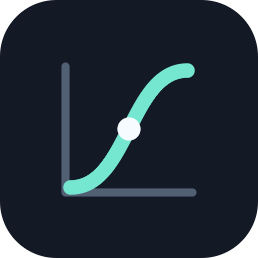

<h1 align="center">
  
  <br>CaptRAW<br>
</h1>
<p align="center">An open-source RAW development workbench for macOS</p>

<p align="center">
  <a href="LICENSE">GPL-3.0-or-later</a> ·
  <a href="CONTRIBUTING.md">Contributing</a> ·
  <a href="CODE_OF_CONDUCT.md">Code of Conduct</a> ·
  <a href="SECURITY.md">Security</a> ·
  <a href="GOVERNANCE.md">Governance</a>
</p>

> 中文 `README.md` 自述文件在 [这里](docs/README_ZH.md) ！

CaptRAW uses a local native core to process RAW files. It provides non-destructive editing, multi-image sessions, masks, geometry correction, presets, comparison tools, and high-quality export. Photos and edit recipes stay on your machine, and the product does not require cloud services or network access.

## Current status

| Item | Version | Status |
|---|---|---|
| Published installation baseline | 0.64 | DMG, source archive, and acceptance identity registered |
| Installation-experience candidate | `0.66.0-beta.1` / `047645006a542a92` | Trustworthy color pipeline and scoped macOS photography workflow delivered; full ACR replacement remains future work |

The [macOS closeout ledger](docs/CLOSEOUT.md) defines the current development and acceptance scope. Installation, signing, hashes, and prior acceptance evidence are recorded in the [acceptance log](docs/ACCEPTANCE.md). Earlier ACR research and acceptance records are retained for traceability only.

The current acceptance target is **macOS 26.0+ on Apple Silicon**. Native builds and product acceptance are not yet implemented for Windows or Linux. See the [platform notes](docs/PLATFORMS.md) for the current boundary.

### Storage differences between the released build and current source

| Item | Released 0.64 | Current 0.66 source |
|---|---|---|
| Edit sidecar | CaptRAW XMP | `.captraw` |
| Adobe XMP | Read and write | Import source only; source XMP is not overwritten |
| User presets | `.xmp` | `.captrawpreset` |
| Original RAW | Never modified | Never modified |

`.captraw` uses a typed, versioned JSON container and does not read the old JSON edit format. Imported Adobe settings require confirmation, and unsupported or ambiguous fields are reported explicitly. See the [engine documentation](docs/ENGINE.md) for the format contract.

## Features

- Local RAW development: white balance, exposure, curves, HSL, color grading, detail, lens, and output color configuration, with a managed float Display P3 SDR monitor path.
- Multi-image workflows: filmstrip, grid, multi-selection, synchronization, per-image undo, batch save, and batch export.
- Masks and repair: brush, linear and radial gradients, color and luminance ranges, object and person-part selection, local adjustments, and repair spots.
- Geometry correction: crop, rotation, straightening, perspective, guided lines, and lens correction.
- Presets and comparison: preset strength, hover preview, favorites, before/after comparison, and multiple split-comparison layouts.
- Output: JPEG and 16-bit TIFF with ICC profiles and selectable target-gamut preview, plus experimental HDR AVIF in the current source.

CaptRAW may use algorithms that differ from Adobe Camera Raw and does not promise identical parameters, functions, or pixels. HDR and remaining ACR alignment boundaries are documented in [HDR](docs/HDR.md), [color grading](docs/COLOR-GRADING.md), and [ACR parity](docs/ACR-PARITY.md).

## Install and use

Installation-experience candidate: [0.66.0-beta.1 DMG](release/0.66.0-beta.1/CaptRAW-0.66.0-beta.1-arm64.dmg). The matching source, dependency licenses, and evidence are in the same directory. The local copy is `~/Applications/CaptRAW-0.66.0-beta.1.app`. The stable installation baseline remains available as `release/CaptRAW-0.64.0-arm64.dmg` and `~/Applications/CaptRAW-0.64.app`.

0.64 and 0.66 are ad-hoc signed and have no Developer ID signature or Apple notarization. A successful local installation does not establish Gatekeeper acceptance on another machine. `0.66.0-beta.1` closes the approved macOS color and workflow scope; it is not a claim of complete ACR parity.

Primary menu shortcuts in the current source:

| Action | Shortcut |
|---|---|
| Open photos | `⌘O` |
| Save CaptRAW edits | `⇧⌘S` |
| Open export settings | `⌘S` |
| Close the current photo | `⌘W` |
| Undo / redo | `⌘Z` / `⇧⌘Z` |
| Fit / 1:1 | `⌘0` / `⌥⌘0` |

Use the adjustment panels on the right after opening a photo. By default, CaptRAW saves a sidecar beside the original using the complete original filename plus `.captraw`. If the recipe references external mask assets, retain the corresponding `.captraw.assets` directory as well. Closing a file or quitting the application prompts before discarding unsaved edits.

Tool interactions and shortcuts may change with the source. For a released build, follow its own menus and interface. Current-source workflow checks live under `tests/e2e/`.

## Build

Building requires Xcode Command Line Tools, ARM64 Node.js 22.13+, pnpm 11.25.0, CMake, Ninja, pkg-config, and Homebrew. CI pins Node.js 22.23.1.

```sh
brew install cmake ninja pkgconf autoconf automake libtool gtkmm3 exiv2 lensfun libomp nlohmann-json librsvg jpeg-turbo fftw little-cms2 aom
corepack enable
corepack prepare pnpm@11.25.0 --activate
pnpm install --frozen-lockfile
pnpm build
```

`pnpm build` uses Turbo to coordinate the contracts, native core, XMP worker, and desktop UI, then validates versions and build outputs. Native builds pin ART commit `1e0e12c62e4f329d30bb5624d62a23a663ffbe6b` and the LibRaw HE branch `3b20539d3faa766a370e93a529a3b87edffbf0f6`. JavaScript dependencies are pinned by `pnpm-lock.yaml`.

```sh
pnpm dev      # start the development workbench
pnpm build:ui # build only shared packages and desktop JavaScript
pnpm package  # build the current ARM64 application and DMG
```

`pnpm dev` requires an existing native core and XMP worker build. Packaging also requires the local model assets to be prepared and verified as described in the [segmentation documentation](docs/SEGMENTATION.md). The installed product does not depend on Homebrew, FFmpeg, or Python.

HDR AVIF builds pin AOM 3.15.0 and libavif 1.4.2. After upgrading Homebrew dependencies, verify their versions and update the pinned information first. If the Electron download host is unavailable, set `ELECTRON_MIRROR` in the build environment; the installer still verifies the digest supplied by the Electron package.

## Verification

Basic checks and unit tests:

```sh
pnpm ci:check
pnpm test:unit
```

Installation-level and E2E results must be tied to a candidate build:

```sh
pnpm candidate:build
CAPTRAW_CANDIDATE=<candidate-id> pnpm test:gate macos-smoke
```

For direct debugging, run `pnpm test:e2e:dev`. Those results are marked as candidate-unverified and cannot be recorded as installation acceptance. Tests are organized by layer and feature domain. See [tests/README.md](tests/README.md) and the [suite manifest](tests/suites.json) for entry points, fixtures, and environment variables.

Background E2E runs in a hidden, non-focusable Electron window. Passing control, screenshot, and pixel checks does not mean a user has completed visible-window acceptance, cross-machine installation, or Gatekeeper acceptance. Test evidence is written under `artifacts/`. Fixture authorization and SHA-256 records are listed in the [fixture manifest](tests/fixtures/fixtures.json).

## Repository layout

| Path | Responsibility |
|---|---|
| `native/` | Headless C++ core, upstream patches, native interfaces, and test resources. |
| `apps/desktop/` | React workbench, Electron main/preload, and Vite configuration. |
| `packages/contracts/` | Cross-process contracts, parameter validation, presets, and synchronization types. |
| `packages/desktop-core/` | Node-only engine, document, editing, preset, profile, and export services. |
| `scripts/` | Source pinning, builds, candidates, packaging, dependencies, and fixture scripts. |
| `tests/` | Unit, native, integration, E2E, and research probes. |

Internal packages use `workspace:*`. Cross-package imports go through domain entry points, and `build:app` validates contract versions, native ready versions, and package exports.

## CI

Pull requests and pushes to `main` run the Ubuntu JavaScript check suite: a frozen install followed by `pnpm ci:check`. A `v*` tag or manual run executes the macOS ARM64 smoke workflow: build and freeze a candidate, prepare Electron and the fixed RAW fixture, then run the `macos-smoke` gate.

CI does not build a DMG or publish a release. Workflow configuration, local development builds, installed packages, and human-visible acceptance are evaluated separately. A workflow definition is not evidence of a successful remote run until that run has actually occurred.

## License and community

CaptRAW is licensed under [GPL-3.0-or-later](LICENSE). Copyright and third-party notices are provided in [COPYRIGHT](COPYRIGHT) and [THIRD_PARTY.md](THIRD_PARTY.md). Before contributing, read the [contribution guide](CONTRIBUTING.md), [Code of Conduct](CODE_OF_CONDUCT.md), and [security policy](SECURITY.md). Maintenance and decision rules are documented in [GOVERNANCE.md](GOVERNANCE.md).

The complete version history is in [CHANGELOG.md](CHANGELOG.md). Current behavior and feature status should be verified against the source, tests, and closeout ledger.
